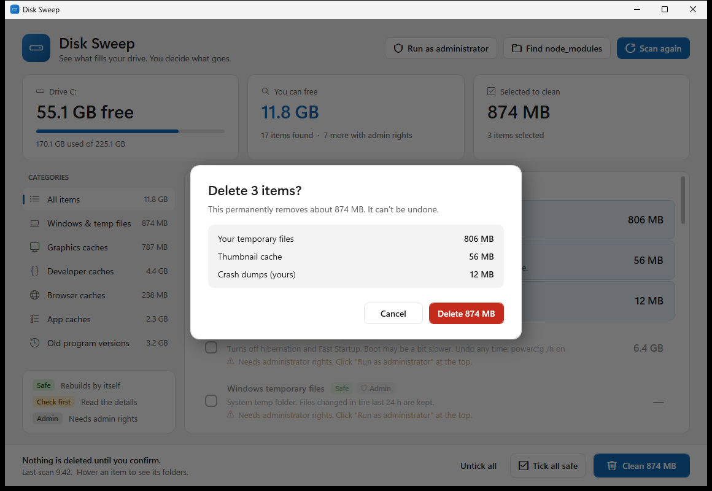
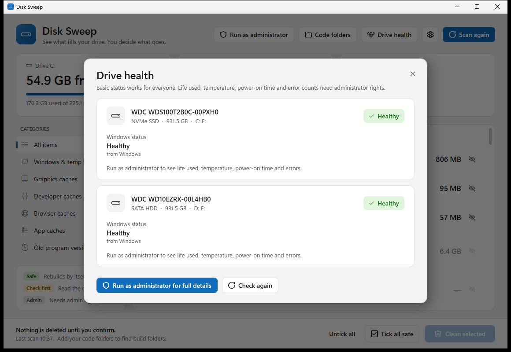
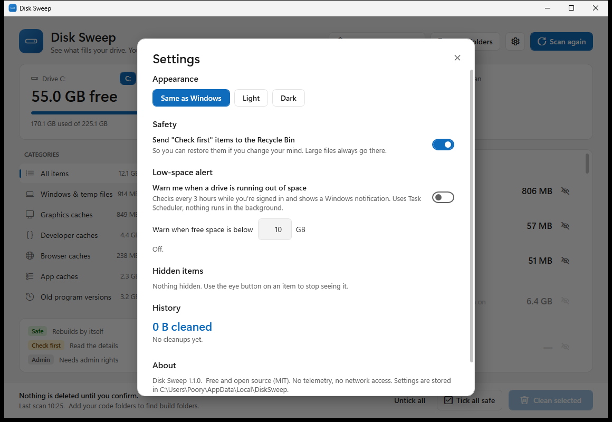
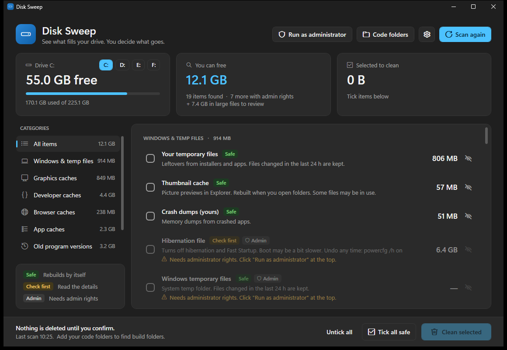

<p align="center">
  
</p>

<h1 align="center">Disk Sweep</h1>

<p align="center">
  <b>See what fills your Windows drive. You decide what goes.</b><br>
  A small, free, open-source disk cleaner that never deletes anything you did not tick and confirm.
</p>

<p align="center">
  <a href="https://github.com/PooryaShadfar/Windows-Disk-Sweep/releases/latest"></a>
  
  
  <a href="LICENSE"></a>
</p>

<p align="center">
  
</p>

## Why

Windows drives fill up quietly. Graphics cards save shader caches, package managers keep every download, browsers and apps keep big caches, and old program versions leave folders behind. None of it shows up in "Apps", so it is hard to find.

Disk Sweep scans the usual places, shows how much each one takes, and lets you pick what to remove.

## Features

- **You stay in control.** Nothing is ticked for you, and nothing is deleted until you confirm a list of exactly what goes.
- **Clear sizes.** Every item shows how much space it frees. Category totals sit in the sidebar.
- **Honest labels.** Every item is marked **Safe** (rebuilds by itself), **Check first** (read the note) or **Admin** (needs administrator rights).
- **Warns about open apps.** If Chrome, VS Code, Node or another app is using the files, Disk Sweep tells you to close it first.
- **Cleans your code folders.** Add your code folders once. Every scan then lists `node_modules`, build caches (`.next`, `.nuxt`, `.turbo`, …), .NET `bin`/`obj`, Rust `target`, Gradle `build`, Python virtual environments and `__pycache__`.
- **Finds leftovers of removed apps.** Lists folders in AppData whose app is no longer installed and that haven't changed in over 30 days.
- **Shows your largest files.** Lists the biggest files in your folders, such as old zips, videos and installers. These always go to the **Recycle Bin**, never straight to deletion.
- **Undo-friendly.** "Check first" items go to the Recycle Bin by default, so a mistake can be undone.
- **All your drives.** Switch between C:, D:, E: and so on in the drive card.
- **Drive health.** See whether each SSD and HDD is healthy. As administrator you also see SSD life used, temperature, power-on time, error counts and HDD SMART warnings such as replaced sectors.
- **Low-space and health alert.** Optional: Windows notifies you when a drive drops below a limit you set or reports a health problem.
- **Hide items.** Click the eye button to never see an item again. You can bring it back in Settings.
- **History.** See how much you've cleaned in total.
- **Safe deletion.** It never follows links or junctions out of a folder, so pnpm stores and git worktrees can't pull in files from elsewhere. It handles very long paths and skips files that are in use.
- **Modern UI.** Light, dark, or the same as Windows. You choose in Settings. Works with the keyboard and screen readers.
- **Tiny and portable.** One ~200 KB `.exe`, no installer, no telemetry, no network access. It uses the .NET Framework 4.8 that ships with Windows.

<p align="center">
  
</p>

<p align="center">
  
</p>

<p align="center">
  
  
</p>

## Download

1. Go to **[Releases](https://github.com/PooryaShadfar/Windows-Disk-Sweep/releases/latest)** and download `DiskSweep.exe`.
2. Double-click it. No installation needed.

> **Windows SmartScreen** may say "Windows protected your PC" because the app is new and not code-signed. Click **More info → Run anyway**. You can also [build it yourself](#build-from-source) from this source code.

**Requirements:** Windows 10 or 11 (64-bit). .NET Framework 4.8 is already part of Windows 10 (version 1903 or later) and Windows 11.

## How to use

1. **Open Disk Sweep.** It scans automatically. A scan usually takes under a minute.
2. **Optional: add your code folders.** Click **Code folders** so build folders show up too.
3. **Look through the list.** Use the categories on the left to focus. Hover over an item to see its folders.
4. **Tick what you want gone.** You can also use **Tick all safe**.
5. **Click "Clean".** Check the list in the confirmation dialog, then confirm.
6. **See the result.** Disk Sweep shows what each item freed, then scans again.

Some system folders need **Run as administrator**. These items show in grey until you restart Disk Sweep with admin rights.

## What it can clean

| Category | Examples | Notes |
|---|---|---|
| Windows & temp files | Recycle Bin, your temp files, Windows temp, Windows Update downloads, Delivery Optimization cache, crash dumps, error reports, thumbnail cache | Temp files changed in the last 24 h are kept |
| Windows (advanced) | Hibernation file, old component versions (WinSxS cleanup with DISM) | Admin only. Hibernation can be turned back on with `powercfg /h on` |
| Graphics caches | NVIDIA, AMD, Intel and DirectX shader caches, old NVIDIA driver downloads | Games may stutter briefly the first time after cleaning |
| Driver installer leftovers | `C:\AMD`, `C:\NVIDIA`, `C:\Intel` | Driver installers unpack here and never clean up |
| Developer caches | npm, pnpm, Yarn, Bun, pip, NuGet, Gradle, Go, Cargo, Playwright browsers | Packages download again when needed |
| Browser caches | Chrome, Edge, Brave, Vivaldi, Opera, Firefox | Only the cache. Logins, history and bookmarks stay |
| App caches | VS Code, Cursor, Windsurf, Discord, Slack, Figma, Postman, ClickUp, Spotify, Steam, Telegram | Only the cache. Settings and data stay |
| Old program versions | Older JetBrains IDE folders (for example `WebStorm2025.3`) | Keeps your newest version and skips versions that are still installed |
| Leftovers of removed apps | AppData folders of apps that are no longer installed | Only folders over 50 MB, unchanged for 30+ days. Always "Check first" |
| Large files | The 40 biggest files (100 MB+) in your folders and on the selected drive | Always go to the Recycle Bin. Installed games and app folders are skipped |
| Project build folders | `node_modules`, `.next`/`.nuxt`/`.turbo`/`.svelte-kit`/`.angular`/`.vite`, .NET `bin`/`obj`, Rust `target`, Gradle `build`, Python venvs and `__pycache__` in your code folders | Your code stays. Each item says how to restore it |

Items under 1 MB are hidden to keep the list short. On drives other than the Windows drive, Disk Sweep shows that drive's Recycle Bin, large files and code folders.

## Safety

- Deletes only what you tick, and only after a confirmation that lists each item and its size.
- Never removes your own files on its own. Personal files only appear under **Large files**, only go if you tick them, and always go to the Recycle Bin.
- Skips installed games and programs. A folder with program files (`.dll`, or an `.exe` next to typical game folders) is never listed as large files.
- Never follows junctions or symbolic links. It removes the link itself, never the target.
- Skips files that are in use instead of forcing them.
- Tells you if an item was only partly cleaned.
- Large files, and "Check first" items by default, go to the **Recycle Bin**, so you can restore them. If something is too big for the Recycle Bin, Windows asks before deleting it for good.
- "Safe" items (caches that rebuild themselves) are deleted directly.
- No internet access, no telemetry, no background service. The optional low-space alert is a normal Task Scheduler entry that you can switch off in Settings.

## Settings

Click the gear button to open Settings:

- **Appearance:** same as Windows, Light or Dark.
- **Safety:** send "Check first" items to the Recycle Bin (on by default).
- **Low-space and health alert:** get a Windows notification when a drive drops below a limit you set or reports a health problem. It checks every 3 hours while you're signed in, and notifies you at most once a day.
- **Hidden items:** bring back items you hid.
- **History:** total space cleaned and your recent cleanups.

Settings are plain text files in `%LOCALAPPDATA%\DiskSweep`.

## Drive health

Click **Drive health** (or the health badge in the drive card) to see every SSD and HDD:

| Shown | Needs admin | Where it comes from |
|---|---|---|
| Model, SSD or HDD, NVMe/SATA/USB, size, drive letters | No | Windows storage info |
| Overall status: **Healthy**, **Needs attention** or **At risk** | No | Windows health status, plus the checks below when available |
| SSD life used (%) | Yes | The drive's wear counter |
| Temperature and highest temperature | Yes | Drive sensors |
| Power-on time, power cycles | Yes | Drive counters |
| Uncorrected read and write errors | Yes | Drive counters |
| HDD: replaced sectors, pending sectors, failure prediction | Yes | SMART data |

Disk Sweep only reads this data. It never writes to a drive's firmware or settings. Some USB enclosures and older drives don't pass health data to Windows, so for them only the basic status shows.

"Needs attention" means one of these: Windows reports a warning, the SSD has used 80% or more of its rated life, the drive replaced bad sectors, sectors are waiting to be replaced, uncorrected errors happened, or the drive runs hot. "At risk" means Windows reports the drive as unhealthy, the drive predicts its own failure, the SSD's rated life is used up, or many sectors were replaced. If a drive is at risk, back up your files.

## Build from source

You need nothing besides Windows. The C# compiler is part of the .NET Framework that ships with Windows.

```bat
git clone https://github.com/PooryaShadfar/Windows-Disk-Sweep.git
cd Windows-Disk-Sweep
build.cmd
```

The app is written to `bin\DiskSweep.exe`.

### Developer options

```bat
bin\DiskSweep.exe --report scan.txt [codeFolder]   :: scan only, write results to a text file
bin\DiskSweep.exe --selftest <emptyFolder>         :: test the delete logic on a generated fixture
bin\DiskSweep.exe --test-item <folder>             :: show <folder> as a deletable item, for UI testing
bin\DiskSweep.exe --test-recycle <path>            :: same, but the item goes to the Recycle Bin
bin\DiskSweep.exe --check-space                    :: the low-space and health check that Task Scheduler runs
bin\DiskSweep.exe --health-report health.txt       :: write drive health to a text file (run as admin for full data)
```

### Project layout

```
src/Engine.cs        what to look for, how to measure it, how to delete it
src/Finders.cs       removed-app leftovers, large files, project build folders
src/Settings.cs      settings, hidden items, history, low-space alert
src/Health.cs        SSD/HDD health: status, wear, temperature, SMART
src/App.cs           WPF window logic, theme, dialogs, settings page
src/MainWindow.xaml  the layout and styles
assets/              app icon and the script that draws it
build.cmd            one-step build
```

## Contributing

Issues and pull requests are welcome. To add a new cleanup location, add an entry in `Scanner.Build()` in [`src/Engine.cs`](src/Engine.cs). Every entry needs a clear name, a short note, and a **Safe** or **Check first** label. Please only add folders that are real caches or leftovers, never user data.

## License

[MIT](LICENSE)
