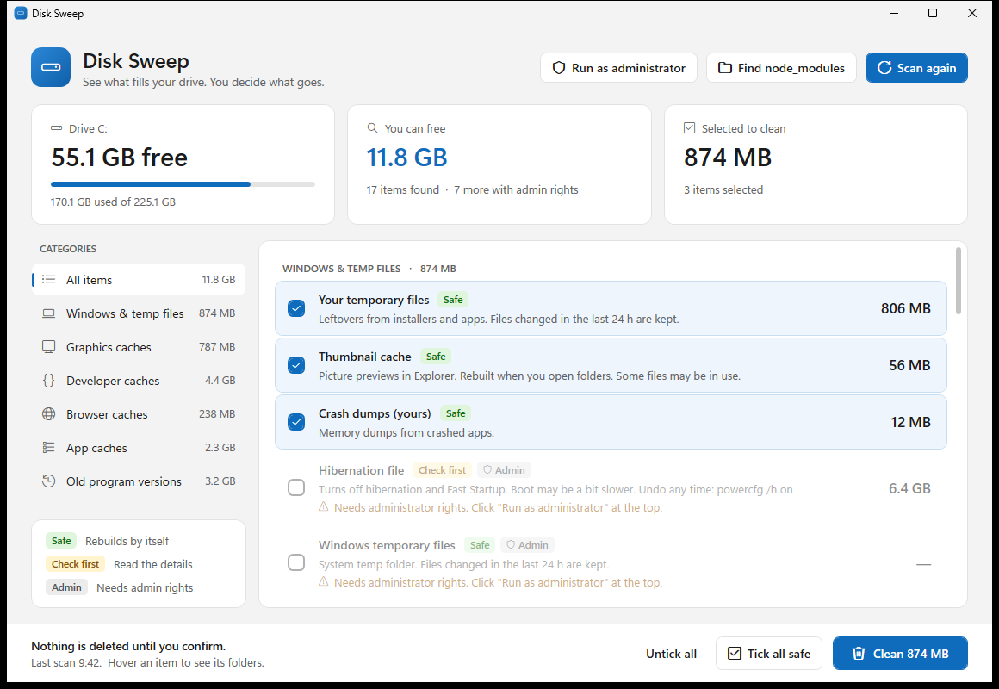

<p align="center">
  
</p>

<h1 align="center">Disk Sweep</h1>

<p align="center">
  <b>See what fills your Windows drive. You decide what goes.</b><br>
  A small, free, open-source disk cleaner that never deletes anything you did not tick and confirm.
</p>

<p align="center">
  <a href="https://github.com/PooryaShadfar/Windows-Disk-Sweep/releases/latest"></a>
  
  
  <a href="LICENSE"></a>
</p>

<p align="center">
  
</p>

## Why

Windows drives fill up quietly. Graphics cards save shader caches, package managers keep every download, browsers and apps keep big caches, and old program versions leave folders behind. None of it shows up in "Apps", so it is hard to find.

Disk Sweep scans the usual places, shows how much each one takes, and lets you pick what to remove.

## Features

- **You stay in control.** Nothing is ticked for you, and nothing is deleted until you confirm a list of exactly what goes.
- **Clear sizes.** Every item shows how much space it frees. Category totals sit in the sidebar.
- **Honest labels.** Every item is marked **Safe** (rebuilds by itself), **Check first** (read the note) or **Admin** (needs administrator rights).
- **Warns about open apps.** If Chrome, VS Code, Node or another app is using the files, Disk Sweep tells you to close it first.
- **Finds project `node_modules`.** Point it at your code folder. It lists every `node_modules` folder with its size and the project's last change date.
- **Safe deletion.** It never follows links or junctions out of a folder, so pnpm stores and git worktrees can't pull in files from elsewhere. It handles very long paths and skips files that are in use.
- **Modern UI.** Follows the Windows light or dark theme. Works with the keyboard and screen readers.
- **Tiny and portable.** One ~130 KB `.exe`, no installer, no telemetry, no network access. It uses the .NET Framework 4.8 that ships with Windows.

<p align="center">
  
</p>

## Download

1. Go to **[Releases](https://github.com/PooryaShadfar/Windows-Disk-Sweep/releases/latest)** and download `DiskSweep.exe`.
2. Double-click it. No installation needed.

> **Windows SmartScreen** may say "Windows protected your PC" because the app is new and not code-signed. Click **More info → Run anyway**. You can also [build it yourself](#build-from-source) from this source code.

**Requirements:** Windows 10 or 11 (64-bit). .NET Framework 4.8 is already part of Windows 10 (version 1903 or later) and Windows 11.

## How to use

1. **Open Disk Sweep.** It scans automatically. A scan usually takes under a minute.
2. **Look through the list.** Use the categories on the left to focus. Hover over an item to see its folders.
3. **Tick what you want gone.** You can also use **Tick all safe**.
4. **Click "Clean".** Check the list in the confirmation dialog, then confirm.
5. **See the result.** Disk Sweep shows what each item freed, then scans again.

Some system folders need **Run as administrator**. These items show in grey until you restart Disk Sweep with admin rights.

## What it can clean

| Category | Examples | Notes |
|---|---|---|
| Windows & temp files | Recycle Bin, your temp files, Windows temp, Windows Update downloads, Delivery Optimization cache, crash dumps, error reports, thumbnail cache | Temp files changed in the last 24 h are kept |
| Windows (advanced) | Hibernation file, old component versions (WinSxS cleanup with DISM) | Admin only. Hibernation can be turned back on with `powercfg /h on` |
| Graphics caches | NVIDIA, AMD, Intel and DirectX shader caches, old NVIDIA driver downloads | Games may stutter briefly the first time after cleaning |
| Developer caches | npm, pnpm, Yarn, Bun, pip, NuGet, Gradle, Go, Cargo, Playwright browsers | Packages download again when needed |
| Browser caches | Chrome, Edge, Brave, Vivaldi, Opera, Firefox | Only the cache. Logins, history and bookmarks stay |
| App caches | VS Code, Cursor, Windsurf, Discord, Slack, Figma, Postman, ClickUp, Spotify, Steam, Telegram | Only the cache. Settings and data stay |
| Old program versions | Older JetBrains IDE folders (for example `WebStorm2025.3`) | Keeps your newest version and skips versions that are still installed |
| Project `node_modules` | Every `node_modules` in a folder you pick | Your code stays. Run `npm install` to restore |

Items under 1 MB are hidden to keep the list short.

## Safety

- Deletes only what you tick, and only after a confirmation that lists each item and its size.
- Never touches your documents, pictures, downloads or desktop.
- Never follows junctions or symbolic links. It removes the link itself, never the target.
- Skips files that are in use instead of forcing them.
- Tells you if an item was only partly cleaned.
- No internet access, no telemetry, no background service, no auto-start.

Deleted files do **not** go to the Recycle Bin. Disk Sweep only lists caches and leftovers, but read the **Check first** items before ticking them.

## Build from source

You need nothing besides Windows. The C# compiler is part of the .NET Framework that ships with Windows.

```bat
git clone https://github.com/PooryaShadfar/Windows-Disk-Sweep.git
cd Windows-Disk-Sweep
build.cmd
```

The app is written to `bin\DiskSweep.exe`.

### Developer options

```bat
bin\DiskSweep.exe --report scan.txt [codeFolder]   :: scan only, write results to a text file
bin\DiskSweep.exe --selftest <emptyFolder>         :: test the delete logic on a generated fixture
bin\DiskSweep.exe --test-item <folder>             :: show <folder> as a deletable item, for UI testing
```

### Project layout

```
src/Engine.cs        what to look for, how to measure it, how to delete it
src/App.cs           WPF window logic, theme, dialogs
src/MainWindow.xaml  the layout and styles
assets/              app icon and the script that draws it
build.cmd            one-step build
```

## Contributing

Issues and pull requests are welcome. To add a new cleanup location, add an entry in `Scanner.Build()` in [`src/Engine.cs`](src/Engine.cs). Every entry needs a clear name, a short note, and a **Safe** or **Check first** label. Please only add folders that are real caches or leftovers, never user data.

## License

[MIT](LICENSE)
